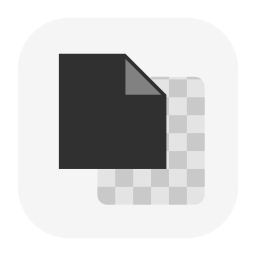
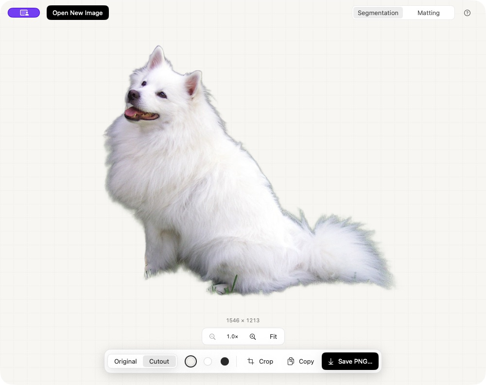

  

<h1 align="center">Cutout</h1>

Remove image backgrounds offline on your Mac.

  <a href="https://github.com/ericfzhu/cutout/releases/latest">Download for Mac</a> ·
  <a href="CHANGELOG.md">What's new</a> ·
  <a href="docs/DEVELOPMENT.md">Build from source</a>

*Sample image from [PyTorch Hub](https://github.com/pytorch/hub/blob/master/images/dog.jpg).*

## Download

Get the app ZIP from [Releases](https://github.com/ericfzhu/cutout/releases/latest),
unzip it, and move **Cutout.app** to Applications.

**Apple Silicon · macOS 14+**. Models and runtime are bundled; no account or
Python installation needed. The app is ad-hoc signed, not notarized, so macOS
may block its first launch.

## Using Cutout

1. **Drop, paste, or open an image.** Background removal starts automatically.
2. **Inspect and crop.** Compare Original/Cutout, change the preview background,
   pinch to zoom, or drag to pan. **Fit** returns to the whole image.
3. **Copy or save** a transparent PNG. Cropping is reversible; preview backgrounds
   never appear in the export.

Use **Segmentation** for solid objects and **Matting** for soft edges or transparency.
Everything runs locally. Fine details and shadows may still need manual editing.

| Action | Shortcut |
| --- | --- |
| Open / paste image | ⌘O / ⌘V |
| Copy / save cutout | ⌘C / ⌘S |
| Zoom in / out | ⌘= / ⌘− |
| Fit to window | ⌘0 |

## More

- [Image processing, limits, and local data](docs/IMAGE-PROCESSING.md)
- [Development, tests, and performance](docs/DEVELOPMENT.md)
- [Third-party notices](THIRD_PARTY_NOTICES.md) — built with BiRefNet and BiRefNet-matting
- [Report a problem](https://github.com/ericfzhu/cutout/issues/new)
